### Hey, I'm Zaw Lwin Htoo 👋

I enjoy turning ideas into working software and learning by building real projects.

---

## ✨ Featured projects

<table>
  <tr>
    <td width="50%" valign="top">
      <h3>🛵 LannPya AI</h3>
      
AI-assisted last-mile delivery tools for merchants and couriers in Myanmar, including Burmese address parsing.

      <a href="https://github.com/ZawLwinHtoo/lannpya-ai">Explore the project →</a>
    </td>
    <td width="50%" valign="top">
      <h3>🍽️ Menu Maker</h3>
      
A web app for creating and managing menus.

      <a href="https://github.com/ZawLwinHtoo/menu-maker">Explore the project →</a>
    </td>
  </tr>
  <tr>
    <td width="50%" valign="top">
      <h3>🅿️ Parking Management System</h3>
      
A parking project organized around user and admin interfaces with supporting backends.

      <a href="https://github.com/ZawLwinHtoo/parking-management-system">Explore the project →</a>
    </td>
    <td width="50%" valign="top">
      <h3>🌱 Always learning</h3>
      
Experimenting with web development, software projects, and new ways to make useful things.

      <a href="https://github.com/ZawLwinHtoo?tab=repositories">Browse all repositories →</a>
    </td>
  </tr>
</table>

## 🧰 Technologies

  
  
  
  
  

## 📌 Find me

- GitHub: [@ZawLwinHtoo](https://github.com/ZawLwinHtoo)
- Take a look at my [pinned projects](https://github.com/ZawLwinHtoo?tab=repositories)

*Still learning. Still building. Still enjoying the bugs.* 🐛

