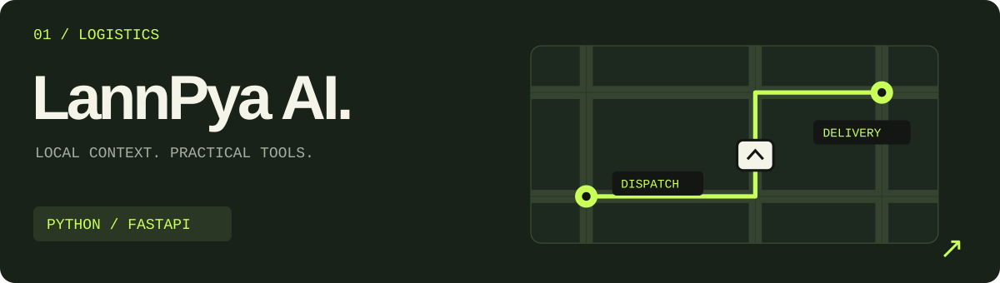
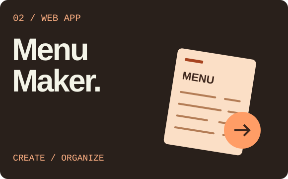
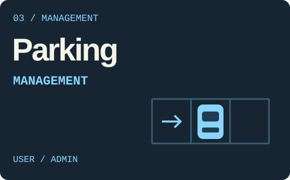

<picture>
  <source media="(max-width: 600px)" srcset="assets/profile-banner-mobile.svg">
  
</picture>

  <b>Hi, I'm Zaw.</b> I turn ideas into working software, one experiment at a time. 
  Web apps, useful tools, and a healthy curiosity about what happens when things break.

  <a href="#selected-builds">Selected builds</a> &nbsp; / &nbsp;
  <a href="#the-toolbox">The toolbox</a> &nbsp; / &nbsp;
  <a href="https://github.com/ZawLwinHtoo?tab=repositories">All repositories ↗</a>

 

## Selected builds

<a href="https://github.com/ZawLwinHtoo/lannpya-ai">
  <picture>
    <source media="(max-width: 600px)" srcset="assets/project-lannpya-mobile.svg">
    
  </picture>
</a>

Delivery tooling for Myanmar merchants and couriers: Burmese address parsing, dispatcher workflows, and rider queues. [Explore LannPya AI →](https://github.com/ZawLwinHtoo/lannpya-ai)

<table>
<tr>
<td width="50%" valign="top">

**Menu Maker** 
A web app for creating and managing menus.

[Explore the project →](https://github.com/ZawLwinHtoo/menu-maker)

</td>
<td width="50%" valign="top">

**Parking Management** 
User and admin interfaces with supporting backends.

[Explore the project →](https://github.com/ZawLwinHtoo/parking-management-system)

</td>
</tr>
</table>

 

## The toolbox

Languages from my projects. Always room for something new.

  
  
  
  
  

 

<a href="https://github.com/ZawLwinHtoo?tab=repositories">
  <picture>
    <source media="(max-width: 600px)" srcset="assets/afterword-mobile.svg">
    
  </picture>
</a>
