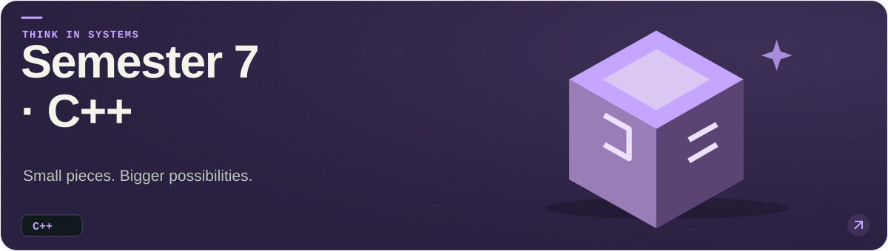
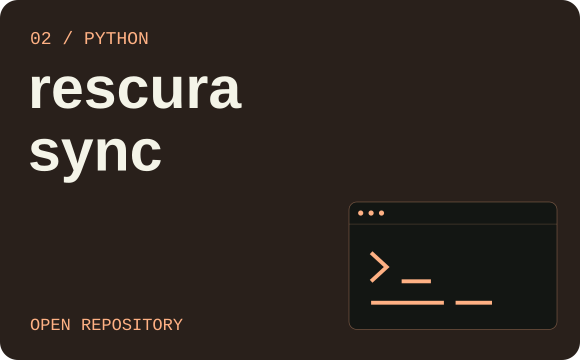
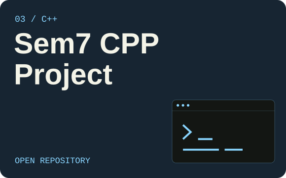
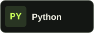
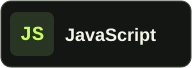
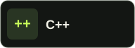
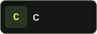
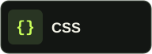
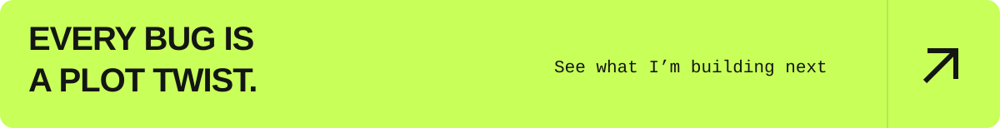

<picture>
  <source media="(max-width: 600px)" srcset="assets/profile-banner-mobile.svg">
  
</picture>

  <b>Hi, I'm Zaw Lwin Htoo.</b> 
  Enjoy bugs!!!

  <a href="#selected-builds">Selected builds</a> &nbsp; / &nbsp;
  <a href="#the-toolbox">The toolbox</a> &nbsp; / &nbsp;
  <a href="https://github.com/ZawLwinHtoo?tab=repositories">All repositories ↗</a>

 

## Selected builds

Three at a time, rotating through 13 public repositories. Refreshes automatically about every 30 minutes.

<a href="https://github.com/ZawLwinHtoo/NCC-">
<picture>
  <source media="(max-width: 600px)" srcset="assets/build-1-mobile.svg">
  
</picture>
</a>

<b>NCC</b> 
Config files for my GitHub profile.

<a href="https://github.com/ZawLwinHtoo/NCC-">Explore the project →</a>

<table>
<tr>
<td width="50%" valign="top">

<b>rescura sync</b> 
Explore the code and project files.

<a href="https://github.com/ZawLwinHtoo/rescura-sync">Explore the project →</a>

</td>
<td width="50%" valign="top">

<b>sce release management</b> 
Explore the code and project files.

<a href="https://github.com/ZawLwinHtoo/sce-release-management">Explore the project →</a>

</td>
</tr>
</table>

 

## The toolbox

Languages from my projects. Always room for something new.

  
  
  
  
  

 

<a href="https://github.com/ZawLwinHtoo?tab=repositories">
  <picture>
    <source media="(max-width: 600px)" srcset="assets/afterword-mobile.svg">
    
  </picture>
</a>
